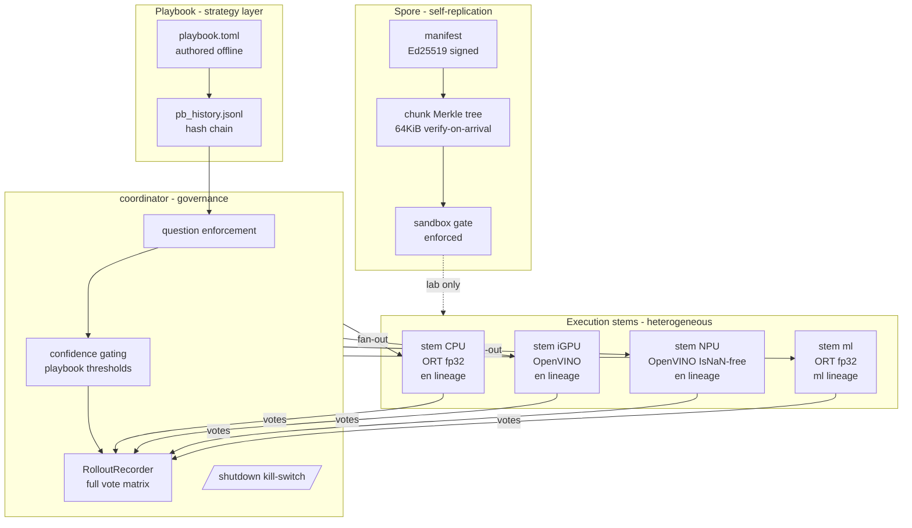

# PandoSI

**The forest that is one tree.**

PandoSI is a research project building an elastically scalable, fully
heterogeneous, self-replicating **unified intelligence** — many cheap
devices, one mind.

- **Pando** — the largest single organism on Earth: an aspen colony of
  ~47,000 stems that looks like a forest but shares one root system.
  Latin: *I spread*.
- **SI** — Super Intelligence.

## Headline results (all measured; each has a run behind it)

| result | number | round |
|---|---|---|
| live three-tier fleet, held-out wording (split D) | **0.9833 decided**; 195/240 auto-executed, **every one correct** | 160 |
| same discipline on a brand-new intent family (F) | 0.9833; auto 99 @ 0.9899 with the 8B tier + neutral confidences | 164-165 |
| the project trained its own best member | 0.7333 -> 0.9125 on wording it had never seen | 150 |
| a replica member | bought nothing (identical answers), then cost 56% of throughput | 146/155 |
| cross-NAT member (Mac, Cloudflare tunnels) | correctness preserved; p50 329 -> 1236 ms - the price, priced | 164 |

**The rules the measurements produced:** opinions buy intelligence; stems
spend latency (155) · auto-execution requires the measured-strongest
member's assent (159-160) · the trusted witness is per *family*, and a
fitted advisor scores zero outside its family (164) · a choice-only member
never prices confidence (165) · reasoning tokens are not a tier: thinking
mode tied or lost to standard at ~60x latency here (167) · on 16 GB, one
resident LLM tier per role - co-residency costs the tail, not the mean
(163).

## Quickstart

```bash
git clone https://github.com/JewelRoam/Pando.git && cd Pando
pip install -e .[runtime]
python -m unittest discover -s tests   # 29 smoke tests, stdlib-only
python tools/demo.py                   # live two-group swarm demo, no GPU needed
```

The two commands above give you a live demo. To go further:

```bash
python -m pando doctor --plan       # safe onboarding plan
python -m pando join                # local root + stem (loopback)
python -m pando doctor              # capability report
```

**Real voter in two commands** (uses the 19 KB member shipped in
`assets/`; no GPU, no download):

```bash
python -m pando root --combiner assets/combiner.json
python -m pando join --backend text --root http://127.0.0.1:8080
```

LAN and persistent services require explicit, expiring grants:

```bash
python -m pando grants grant lan_listen --resource 0.0.0.0:8080 --hours 24 --yes
python -m pando grants grant service_autostart --resource user-agent/pando --hours 24 --yes
python -m pando.service --role root
```

Installed-package form: `pip install "pando[runtime]"` or from GitHub:
`pip install "pando[runtime] @ git+https://github.com/JewelRoam/Pando.git@main"`.
Real-model mode: export ONNX then `python -m pando.join --backend onnx
--onnx-path artifacts/laya-en.int8.onnx`. Measured end-to-end:
**1.51 s** from root launch to decision — `tools/quickstart_check.py`.

## Capability inventory

See [What Works Today](docs/WHAT-WORKS.md) for the full list of
verified capabilities — decision-model swarm, heterogeneous execution,
signed self-replication, playbook governance, and more — each measured
on real hardware.

## Architecture



### Data flow

1. **Playbook** (TOML) defines: question schemas, confidence gating, action bindings
2. **coordinator** validates: question in playbook, thresholds from [gating]
3. **Fan-out**: request sent to k stems with checkpoint diversity
4. **Votes collected**: each stem runs Laya inference, returns {choice, probability}
5. **Aggregation**: majority vote + tier assignment (auto/verify/escalate)
6. **Rollout recorded**: full vote matrix + playbook_hash for A/B attribution
7. **Evolution**: disagreement pairs exported to RLCD trainer → new lineage

## Docs

- [Blueprint (zh-CN)](docs/BLUEPRINT.zh-CN.md) — architecture v0.7
- [ADOPTION](docs/ADOPTION.md) — three-ring capability model, survival metrics
- [Onboarding (zh-CN)](docs/ONBOARDING.zh-CN.md) — consent tiers, sandbox policy, product UX
- [METRICS](docs/METRICS.md) — dashboard design
- [ROADMAP](docs/ROADMAP.md) — phases with measurable gates
- [Research notes](docs/research/) — 28 rounds of evidence-backed findings
- [TERMUX.md](TERMUX.md) — Android TV box onboarding guide
- [Swarm check](docs/SWARM-CHECK.md) — multi-process tokenized consensus and shrinkage
- [RTX 3070 CUDA worker](docs/CUDA-3070.md) — non-OpenVINO HTTP integration
- [Slow-stem check](tools/slow_stem_check.py) — timeout, cooldown, and retry proof
- [Windows service check](docs/SERVICE-CHECK-WINDOWS.md) — real lifecycle validation record
- [Linux CI service check](docs/SERVICE-CHECK-LINUX-CI.md) — user-syworker lifecycle validation record

## Status

Research preview. Replication
experiments run only in sandboxes. 40-task acceptance suite measured; score
heads documented as informational-only (round 24).
